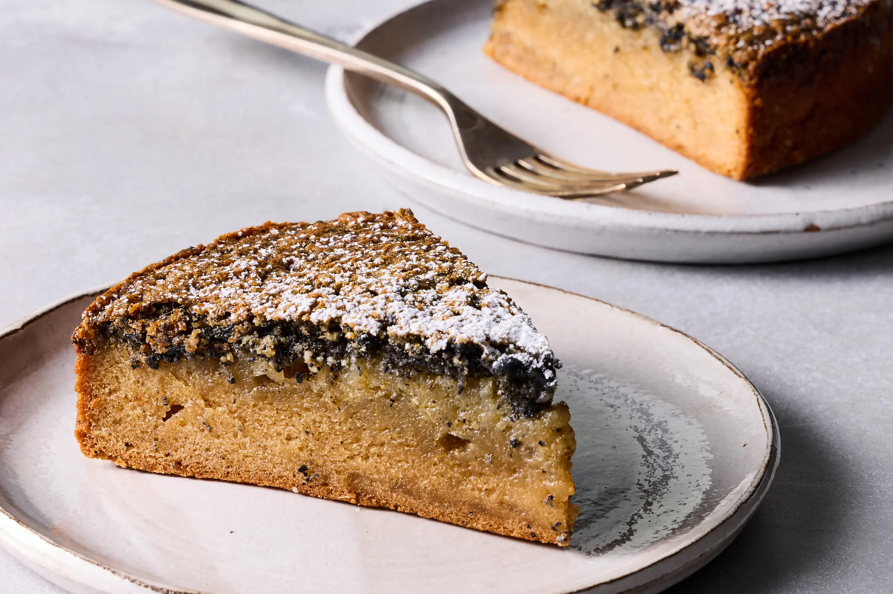

---
tags:
  - dish:dessert
  - difficulty:easy
---
<!-- Tags can have colon, but no space around it -->

# Chewy Black Sesame Cake

<!-- Serves has to be a single number, no dashes, but text is allowed after the
number (e.g., 24 cookies) -->
- Serves: 1 cake
{ #serves }
<!-- Time is not parsed, so anything can be input here, and additional
values can be added (e.g., "active time", "cooking time", etc) -->
- Time: 1 hr 15 min
- Date added: 2026-10-30

## Description
This simple yet regal cake, adapted from Eric Kim’s cookbook “Korean American” (Clarkson Potter, 2022), tastes like a mix between songpyeon, the honey and sesame-filled rice cakes served during Chuseok, the Korean fall harvest festival, and the kind of chewy black sesame rolls you might find at a Korean bakery. The density of the batter forces the celestial black sesame crumble upward so that it forms a perfect black line, which acts as a sweet, nutty brittle atop the squidgy vanilla base.

## Ingredients { #ingredients }

<!-- Decimals are allowed, fractions are not. For ranges, use only a single dash
and no spaces between the numbers. -->
- Cooking spray
- 2 large eggs
- 1 cup/200 grams sugar
- 0.25 cup/84 grams honey
- 0.75 teaspoon coarse kosher salt, such as Morton
- 1 cup/237 milliliters whole milk
- 1 tablespoon vanilla extract
- 2 tablespoons unsalted butter, melted
- 0.5 teaspoon toasted sesame oil
- 4 tablespoons/38 grams toasted black sesame seeds, divided
- 1 teaspoon baking powder
- 8 ounces/227 grams glutinous rice flour (a.k.a. mochiko or sweet rice flour)
- Powdered sugar, for serving

## Directions

<!-- If you have a direction that refers to a number of some ingredient, wrap
the number in asterisks and add `{.ingredient-num}` afterwards. For example,
write `Add 2 Tbsp oil to pan` as `Add *2*{.ingredient-num} to pan`. This allows
us to properly change the number when changing the serves value. -->

1. Heat the oven to 350 degrees. Mist an 8-inch round cake pan with cooking spray.
2. In a large bowl, whisk together the eggs, sugar, honey, and salt until fluffy and pale yellow, 1 to 2 minutes. Whisk in the milk, vanilla, melted butter and sesame oil until combined.
3. Using a mortar and pestle (or a coffee or spice grinder), pulverize 2 tablespoons of the black sesame seeds into a rough powder. It should smell very fragrant. Add this sesame powder, along with the remaining 2 tablespoons of whole black sesame seeds, to the bowl with the egg mixture, followed by the baking powder and rice flour. Whisk to combine, then carefully pour the batter into the greased cake pan.
4. Bake until the top is nicely browned and cracked slightly (this is a good sign), 50 to 60 minutes. You can also insert a chopstick or toothpick into the center of the cake, and if it comes out clean, then you’re done.
5. Cool the cake in pan for 5 minutes, then turn it onto a wire rack and let cool completely before dusting with the powdered sugar and slicing into wedges to serve. This cake will keep in an airtight container at room temperature for up to 5 days.

## Source

[NYTimes](https://cooking.nytimes.com/recipes/790088015-chewy-black-sesame-cake)

## Comments
