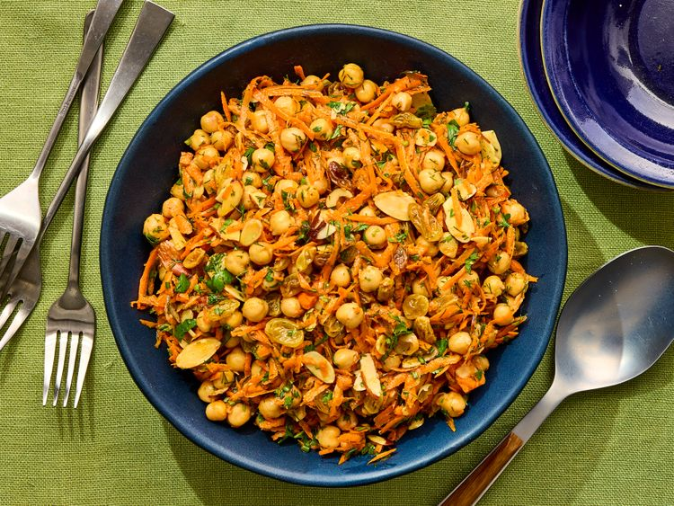

---
tags:
  - dish:salad
  - protein:chickpeas
  - ingredient:carrot
---
<!-- Tags can have colon, but no space around it -->

# Chickpea and Carrot Salad With Raisins and Almonds

<!-- Serves has to be a single number, no dashes, but text is allowed after the
number (e.g., 24 cookies) -->
- Serves: 4
{ #serves }
<!-- Time is not parsed, so anything can be input here, and additional
values can be added (e.g., "active time", "cooking time", etc) -->
- Time: 30 min
- Date added: 2026-10-30

## Description
Because the ingredient list is short, a couple of smart techniques are non-negotiable. First, warming the chickpeas and raisins before dressing them helps both ingredients absorb more flavor. The raisins plump and soften, while the warm chickpeas soak up the limey, smoky dressing more effectively than they would straight from the can.

And while this recipe is short and sweet, please take the extra minute or two to shred your own carrots. Pre-shredded carrots are often dry, tough, and leathery, which makes them a poor substitute here. Freshly grated carrots stay juicy and sweet, and they only take a few minutes on a box grater—or even less time with the shredding disk of a food processor. Personally, I'd rather spend three minutes grating carrots than haul out and clean my food processor, but choose whichever option is less annoying to you.

This is also an ideal make-ahead salad. The flavors continue to melt and improve as it sits, making it perfect for meal prep, cookouts, or chaotic summer gatherings where your kids are outside conducting what increasingly resembles organized water-balloon warfare. Just wait to toss in the herbs and almonds until right before serving so everything stays fresh and crunchy.

- Heating the chickpeas and raisins softens them slightly, helping them absorb flavor more easily. 
- Letting the dressed salad sit briefly allows the flavors to meld; adding the herbs just before serving keeps them fresh.

## Ingredients { #ingredients }

<!-- Decimals are allowed, fractions are not. For ranges, use only a single dash
and no spaces between the numbers. -->

- 2 (15-ounce; 425 g) cans chickpeas, drained and rinsed
- 0.5 cup golden raisins (about 2.5 ounces; 70 g)
- 0.25 cup (60 ml) extra-virgin olive oil
- 2 tablespoons (30 ml) fresh lime juice from 1 lime
- Kosher salt
- Freshly ground black pepper
- 0.25 teaspoon smoked paprika
- Pinch cayenne pepper
- 3 medium carrots (about 7.5 ounces; 212 g), peeled and shredded on the large holes of a box grater or a food processor fitted with the shredding disk
- 0.25 cup (10 g) chopped fresh mint, dill, parsley, or cilantro
- 1 scallion, minced or 1 tablespoon minced fresh chives
- 0.25 cup (20 g) sliced almonds, toasted

## Directions

<!-- If you have a direction that refers to a number of some ingredient, wrap
the number in asterisks and add `{.ingredient-num}` afterwards. For example,
write `Add 2 Tbsp oil to pan` as `Add *2*{.ingredient-num} to pan`. This allows
us to properly change the number when changing the serves value. -->

1. In a medium saucepan, heat chickpeas and raisins over medium heat, stirring, until just warmed through, 3 to 5 minutes. (Alternatively, microwave chickpeas with raisins in a large bowl until hot, about 90 seconds.) Transfer to a large bowl and stir in carrots, oil, lime juice, 3/4 teaspoon kosher salt, 1/4 teaspoon black pepper, smoked paprika, and cayenne, then let sit for 15 to 30 minutes to meld flavors. (At this stage, the salad can be refrigerated in an airtight container for up to 3 days.)
2. When ready to serve, stir in mint (or other herbs), scallion (or chives), and almonds to combine. Season with salt and pepper to taste. Serve.

## Source

[Serious Eats](https://www.seriouseats.com/chickpea-and-carrot-salad-recipe-11983745)

## Comments
