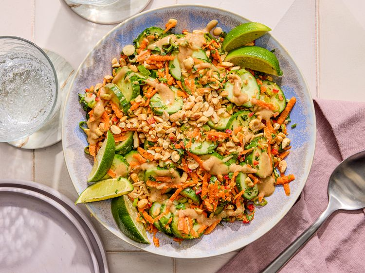

---
tags:
  - dish:salad
  - ingredient:cucumber
  - cuisine:thai
  - difficulty:easy
---
<!-- Tags can have colon, but no space around it -->

# Cucumber Salad with Peanut-Lime Dressing

<!-- Serves has to be a single number, no dashes, but text is allowed after the
number (e.g., 24 cookies) -->
- Serves: 4
{ #serves }
<!-- Time is not parsed, so anything can be input here, and additional
values can be added (e.g., "active time", "cooking time", etc) -->
- Time: 20 min
- Date added: 2026-10-30

## Description
This cucumber salad is loud in all the right ways. Inspired by the punchy, layered flavors of pad Thai, it leans into intensity: nutty peanut butter, pleasantly pungent fish sauce, bright lime juice, and a little kick of heat. But it’s not all about power moves—the cucumbers hold their own and bring balance, adding cool crunch and refreshing contrast to every bite.

Light but satisfying, cooling yet complex, this salad strikes an ideal balance. It’s excellent on its own, but even better as a side for noodle dishes, grilled chicken, steak, or anything hot off the grill. 
### Why it works
- Salting the cucumbers draws out excess moisture and seasons them thoroughly, keeping them crisp and preventing the dressing from turning watery.
- Using English cucumbers eliminates the need for peeling, and their tender, nearly seedless interiors make them well-suited for raw salads.

## Ingredients { #ingredients }

<!-- Decimals are allowed, fractions are not. For ranges, use only a single dash
and no spaces between the numbers. -->

- 2 large English cucumbers (1.5 pounds; 680 g total), sliced into 1/4-inch thick rounds (see notes)
- 1.5 teaspoons Diamond Crystal kosher salt, divided; for table salt, use half as much by volume
- 3 tablespoons creamy, unsweetened peanut butter (see notes)
- 3 tablespoons (45 ml) fresh lime juice (from 2 small limes), plus lime wedges for serving
- 1 packed tablespoon light brown sugar, (about 0.5 ounce; 14 g)
- 1 tablespoon (15 ml) unseasoned rice vinegar
- 1 tablespoon (15 ml) fish sauce
- 1 large garlic clove, minced
- 0.25 cup (60 ml) untoasted sesame oil
- 2 small carrots, peeled, (4 ounces; 57 g total) and shredded on the largest holes of a box grater (about 1 cup packed)
- 2 medium scallions, trimmed and thinly sliced
- 0.5 cup chopped fresh cilantro (0.5 ounce; 14 g)
- 1 small (18 g) Fresno or jalapeño chile, seeded and finely chopped
- 0.5 cup salted, roasted peanuts (2.5 ounces; 70 g), chopped, divided

## Directions

<!-- If you have a direction that refers to a number of some ingredient, wrap
the number in asterisks and add `{.ingredient-num}` afterwards. For example,
write `Add 2 Tbsp oil to pan` as `Add *2*{.ingredient-num} to pan`. This allows
us to properly change the number when changing the serves value. -->

1. In a large bowl, add cucumbers and 1 teaspoon kosher salt; toss to combine. Transfer cucumbers to a colander and set over now-empty bowl. Set aside for 10 minutes.
2. Meanwhile, in a medium bowl, whisk peanut butter, lime juice, brown sugar, vinegar, fish sauce, garlic, and remaining 1/2 teaspoon salt until smooth. Slowly whisk in sesame oil until emulsified; set aside.
3. Pat cucumbers dry with paper towels or a clean kitchen towel. Discard any accumulated liquid in bowl. Transfer cucumbers back into now-empty large bowl.
4. Add carrots, scallions, cilantro, fresno or jalapeño, 1/4 cup peanuts, and half of the reserved peanut-lime dressing to bowl with cucumbers; toss to combine.
5. Transfer cucumber mixture to a large serving bowl or platter. Top with remaining 1/4 cup peanuts and drizzle with remaining dressing. Serve immediately with lime wedges. 

## Notes
- 1.5 pounds of Persian cucumbers can be used in place of the English cucumbers. There’s no need to peel them as their skins are thin and tender.
- If the peanut butter has separated, stir it well before making the dressing. 
## Source

[Serious Eats](https://www.seriouseats.com/cucumber-peanut-salad-recipe-11761140)

## Comments
