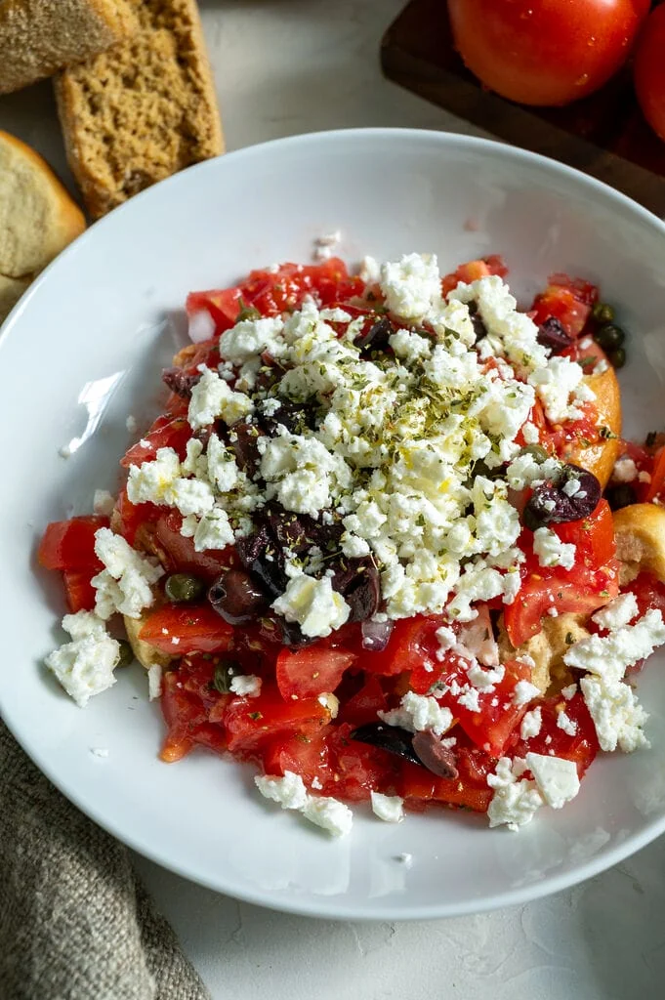

---
tags:
  - dish:salad
  - ingredient:tomato
  - cuisine:greek
  - difficulty:easy
---
<!-- Tags can have colon, but no space around it -->

# Cretan dakos

<!-- Serves has to be a single number, no dashes, but text is allowed after the
number (e.g., 24 cookies) -->
- Serves: 3
{ #serves }
<!-- Time is not parsed, so anything can be input here, and additional
values can be added (e.g., "active time", "cooking time", etc) -->
- Time: 15 min
- Date added: 2026-10-30

## Description
Cretan dakos is often served as a salad, a light meal, or as part of an array of mezedes.  Its basis is a Cretan dry barley rusk (called paximadia in Greek); think of it as a large, super hard crouton.  The rusk is typically topped with the best tomatoes you can find, olive oil, capers, olives, and cheese ... all sorts of healthy deliciousness. The rusk is made of whole grain barley. It is low in fat and very high in fiber.  These rusks must absolutely be softened before eating them but the fact that they are so dry means that they keep well for a long time, in theory; mine never last long enough for this to be a concern.

## Ingredients { #ingredients }

<!-- Decimals are allowed, fractions are not. For ranges, use only a single dash
and no spaces between the numbers. -->
- 1-2 Cretan dry barley rusk you can leave whole, or chop it into thick pieces.
- 2-3 Ripe tomatoes small to medium size
- 1 tbsp Olive oil
- 0.25 teaspoon dried oregano
- Salt, to taste
- 2 tsps Chopped red onion
- 2 tsps Capers
- 2 Kalamata olives, pitted, and chopped
- 2 tbsp Crumbled feta
- 1 Fresh basil leaf, chopped

## Directions

<!-- If you have a direction that refers to a number of some ingredient, wrap
the number in asterisks and add `{.ingredient-num}` afterwards. For example,
write `Add 2 Tbsp oil to pan` as `Add *2*{.ingredient-num} to pan`. This allows
us to properly change the number when changing the serves value. -->
1. Place the rusk(s) in a bowl or plate. You can leave it whole, or chop it up into thick pieces.
2. Cut one tomato in half and grate it into a bowl, discarding the skin as you go. We usually use two small to medium tomatoes to get plenty of juicy grated tomato. 
3. Dice a third small tomato and add it to the bowl. Drizzle in about ½ tablespoon of olive oil, season with salt to taste, and sprinkle in some dried oregano. Give everything a good stir to combine.
4. Slowly spoon the tomato mixture over the barley rusk, making sure to cover the entire surface (or all of the chopped rusk pieces) so they soften evenly.
5. Top with the chopped red onion, capers, olives, and crumbled feta. Finish with another drizzle of olive oil, a sprinkle of dried oregano, and a few fresh basil leaves, if using.
6. We then let our Cretan dakos sit for about 5-10 minutes for all the flavours to combine, and enjoy!

## Notes
- The dry barley rusks used to prepare Cretan dakos are typically quite hard, like be-careful-you-don’t-break-your-teeth hard. So, before eating them, they really do need to be softened up. Most recipes suggest quickly running the dry barley rusk under water to allow it to soften.  Although this obviously works, my method is to soften the rusk with the juices from a grated ripe tomato; much more delicious than water.
- In Crete, dakos salad is usually made with Cretan mizithra or anthotiro, a soft fresh cheese which has a slightly sweet taste and a creamy texture which melts in your mouth. I have a hard time finding this cheese in Canada, so I make my Cretan dakos with feta.  Different, but still amazing!

## Source
[Mia Kouppa](https://miakouppa.com/cretan-dakos/)

## Comments

- 2026-10-30: I typically grate all the tomatoes for this, and more olives. also, some fish sauce.
