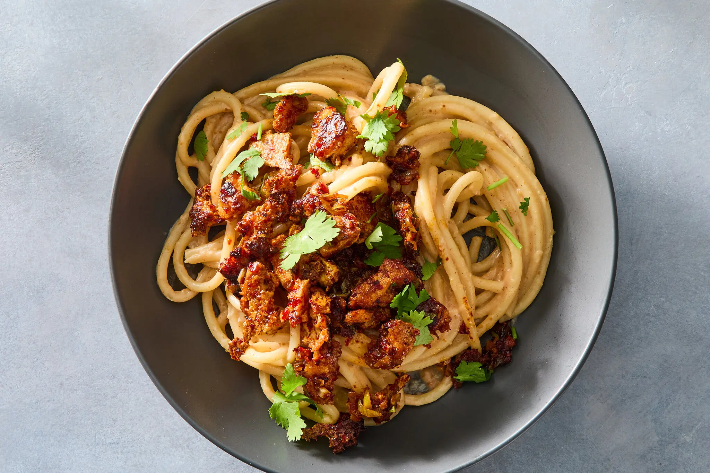

---
tags:
  - dish:main
  - protein:tofu
  - ingredient:pasta
  - difficulty:easy
---
<!-- Tags can have colon, but no space around it -->

# Peanut Noodles With Spicy Tofu 

<!-- Serves has to be a single number, no dashes, but text is allowed after the
number (e.g., 24 cookies) -->
- Serves: 2
{ #serves }
<!-- Time is not parsed, so anything can be input here, and additional
values can be added (e.g., "active time", "cooking time", etc) -->
- Time: 30 min
- Date added: 2026-10-30

## Description
Delicious and well-balanced, this silky noodle recipe starts with a no-cook peanut butter sauce seasoned with pantry ingredients. Bouncy bucatini props up the garlicky-peanut sauce, and the textural and lightly spicy tofu crumble makes the whole dish a meal. The spicy tofu, on its own, can also be eaten with rice or tucked into a banh mi-style sandwich. If you only have regular, sweetened peanut butter, skip the added brown sugar in the recipe. The recipe doubles easily to serve four if desired.

## Ingredients { #ingredients }

<!-- Decimals are allowed, fractions are not. For ranges, use only a single dash
and no spaces between the numbers. -->
- 0.33 unsweetened smooth, natural peanut butter
- 1 tablespoon light brown sugar
- 1 tablespoon rice vinegar or distilled white vinegar
- 2 tablespoons soy sauce, divided
- 4 garlic cloves, finely grated, divided
- Salt
- 4 tablespoons vegetable oil, divided
- 1 (14- to 16-ounce) package extra-firm tofu, drained and gently squeezed to remove excess liquid
- 2 scallions, thinly sliced
- 2 teaspoons gochugaru (Korean red-pepper flakes) or 1 teaspoon crushed red pepper
- 8 ounces bucatini or spaghetti
- Coarsely chopped cilantro leaves and tender stems, for serving 

## Directions

<!-- If you have a direction that refers to a number of some ingredient, wrap
the number in asterisks and add `{.ingredient-num}` afterwards. For example,
write `Add 2 Tbsp oil to pan` as `Add *2*{.ingredient-num} to pan`. This allows
us to properly change the number when changing the serves value. -->

1. Bring a large pot of water to a boil over high.
2. Prepare the sauce: In a small bowl, stir together the peanut butter, brown sugar and vinegar with 1 tablespoon of the soy sauce and half the garlic; season to taste with salt and set aside. (The peanut butter mixture will turn into a thick paste.) 
3. Heat a large cast-iron or heavy-bottomed skillet over low heat until it is hot, 1 to 2 minutes. Add 3 tablespoons of the oil and raise the heat to medium-high. With your hands, crumble the tofu into the pan in a single layer. Let the tofu cook, undisturbed, for about 5 minutes. The tofu that is touching the pan should be golden brown. With a spatula, turn and flip the tofu crumbles and cook, undisturbed, for another 5 minutes. 
4. Add the remaining 1 tablespoon vegetable oil, 1 tablespoon soy sauce, the remaining garlic, the scallions and gochugaru and toss to coat. Lower the heat to medium and cook, stirring occasionally, until the scallions are softened, about 1 minute. Turn the heat off and set the pan aside. 
5. Season the boiling water generously with salt and cook the pasta according to package instructions, 9 to 10 minutes. Drain the pasta, reserve 1 cup of the pasta water, and return the cooked pasta back into the pot. Add the reserved peanut butter mixture and about ¾ cup of the pasta cooking water. Turn the heat on to low and stir the pasta with the sauce until the peanut sauce starts to melt and emulsify with the pasta cooking water and coats the pasta. If the pasta sauce seems too thick, add another splash of pasta cooking water to thin it out. 
6. Divide the peanut noodles between two bowls; top with the tofu crumbles and chopped cilantro.

## Source

[NYTimes](https://cooking.nytimes.com/recipes/776534758-peanut-noodles-with-spicy-tofu)

## Comments

- 2026-10-30: Nora liked the pasta without the tofu. made with spaghetti, not bucatini
