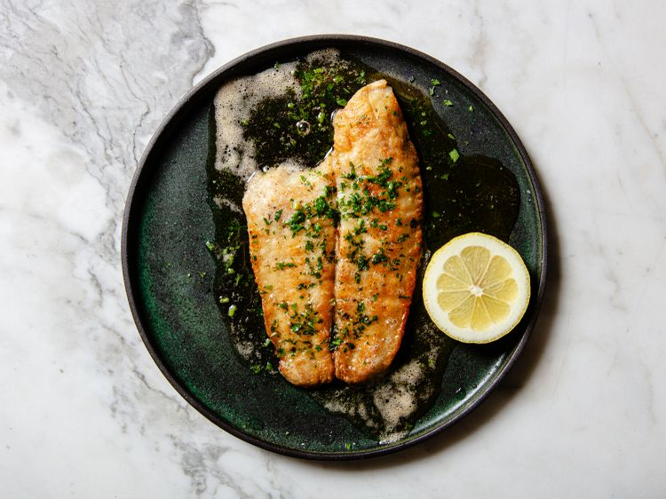

---
tags:
  - dish:main
  - protein:fish
  - cuisine:french
  - difficulty:easy
---
<!-- Tags can have colon, but no space around it -->

# Sole Meunière

<!-- Serves has to be a single number, no dashes, but text is allowed after the
number (e.g., 24 cookies) -->
- Serves: 4
{ #serves }
<!-- Time is not parsed, so anything can be input here, and additional
values can be added (e.g., "active time", "cooking time", etc) -->
- Time: 20 min
- Date added: 2026-10-30

## Description
- Choosing any thin, white-fleshed fish fillet available will work in this dish.
- Utilizing clarified butter ensures a deeply browned exterior on the fish without the risk of burning, enhancing the rich, nutty flavor profile.
- Lemon juice introduces a bright acidity that balances the richness of the brown butter, creating a harmonious flavor contrast that elevates the dish.
- Using a nonstick skillet reduces the risk of the fillets sticking and breaking, allowing consistent browning and a successful culinary execution.

Sole meunière is one of a whole family of European dishes that involve a protein, often fish, in a lemony, buttery pan sauce. There are so many iterations of this basic idea that it's not uncommon for recipe developers to get confused and mistake one for another. A quick search for "sole meunière," for example, turns up plenty of recipes calling for capers (which should more correctly be presented as "piccata," or "grenobloise" if there are also pieces of lemon flesh and tiny croutons), almonds ("amandine"), and breadcrumbs ("à la polonaise"). I'm a big fan of all those variations, they just shouldn't be called a classic meunière.

The traditional method for making sole meunière starts with seasoning and dredging the fish (it supposedly gets its name from the flour dredge, as meunière is the "miller's wife"), browning it in a skillet in clarified butter, transferring the cooked fish to serving dishes and topping it with chopped parsley and fresh lemon juice, and finally spooning some browned butter on top that you make in the skillet after cooking the fish. 

As for the fish itself, the term "sole" isn't a particularly helpful one, as many different fish are sold under that name in the United States, several of which are not actually in the sole family. In France, this would normally be made with Dover sole—a true sole—but it's expensive and can be difficult to find. If you can't find it, don't fret. Any thin, white-fleshed fillet can work, especially ones from a flatfish: lemon sole, grey sole, Petrale sole, and flounder would all be good. Thinner fillets of finfish like scrod, haddock, branzino, and even halibut could also work, though if they get more than about three-quarters of an inch thick you'll start to have trouble getting the fish to cook through quickly.

Working with thin, lean fillets of fish can be tricky—they can stick to a pan and break easily—so this is one instance where I'm all in favor of grabbing a nonstick skillet. In side-by-side tests, I've found that I'm able to achieve excellent, even browning and brown the butter just as nicely in nonstick as in stainless, copper, or carbon steel, and it takes a lot of the potential for error out of the equation. 

## Ingredients { #ingredients }

<!-- Decimals are allowed, fractions are not. For ranges, use only a single dash
and no spaces between the numbers. -->

- All-purpose flour, for dredging (about 0.5 cup)
- 1.5 pounds (680 g) thin boneless, skinless sole or other white-fleshed fish fillets (see notes)
- Kosher salt
- 4 tablespoons (60 g) homemade or store-bought clarified butter, plus more if needed (see notes)
- 6 tablespoons (90 g) unsalted butter, cut into 1-tablespoon pieces
- 1 lemon, cut into wedges, plus more for serving
- 1.5 tablespoons (0.25 ounce; 8 g) flat-leaf parsley leaves and tender stems

## Directions

<!-- If you have a direction that refers to a number of some ingredient, wrap
the number in asterisks and add `{.ingredient-num}` afterwards. For example,
write `Add 2 Tbsp oil to pan` as `Add *2*{.ingredient-num} to pan`. This allows
us to properly change the number when changing the serves value. -->

1. In a wide, shallow bowl or platter, spread flour in an even layer. Line a rimmed baking sheet with parchment paper. Season fish fillets all over with salt. Working with one piece of fish at a time, dredge fillets in flour, shaking off excess. Transfer to prepared baking sheet.
2. Working in two or more batches so that you can comfortably fit fillets in one layer without crowding, heat 2 tablespoons (30g) clarified butter in a large nonstick skillet over medium-high heat until shimmering. Add fish, presentation side down, and cook until well browned on on first side, 3 to 4 minutes (it's okay if the fillets are mostly cooked through at this point). Using two spatulas, if necessary, carefully flip each fillet and continue cooking until just cooked through and flesh is opaque throughout, 30 seconds to 1 minute. Carefully transfer fish, well-browned side up, to a serving platter or plates and keep warm. Repeat with remaining fillets and clarified butter, using 2 tablespoons of clarified butter per batch.
3. Wipe out skillet. Add unsalted butter to skillet, set over medium-high heat and cook until butter is melted and foamy. Continue to cook, swirling pan, until milk solids in butter turn a deep hazelnut brown, 1 to 2 minutes longer. 
4. While butter is browning, squeeze lemon juice all over fish, then sprinkle all over with parsley.
5. When butter is browned, immediately spoon it all over the fish; it should bubble and foam as soon as it hits the fish (this is very fun to do tableside for your guests and adds to the experience). Serve immediately with additional lemon on the side.

## Notes

- True sole from the Soleidae family, most commonly Dover sole, can be both hard to find and expensive. Many other thin, white-fleshed flatfish fillets can work in this recipe, including many that are sold as "sole" even if they're not technically in the Soleidae family, including grey sole, Petrale sole, lemon sole, and flounder. The number of fillets you get will depend on the specific fish you buy; 6-ounce (170g) fillets will yield four perfect portions, but some flatfish yield smaller fillets, in which case you may need to divide the fillets up among diners accordingly.
- Clarified butter is perfect for browning the fish without the risk of the milk solids found in whole butter burning or scorching, while still reinforcing the buttery flavor of the dish. If you don't have clarified butter, you can brown the fish in a neutral oil like vegetable or canola oil instead. 

## Source

[Serious Eats](https://www.seriouseats.com/sole-meuniere-recipe-5649376)

## Comments
